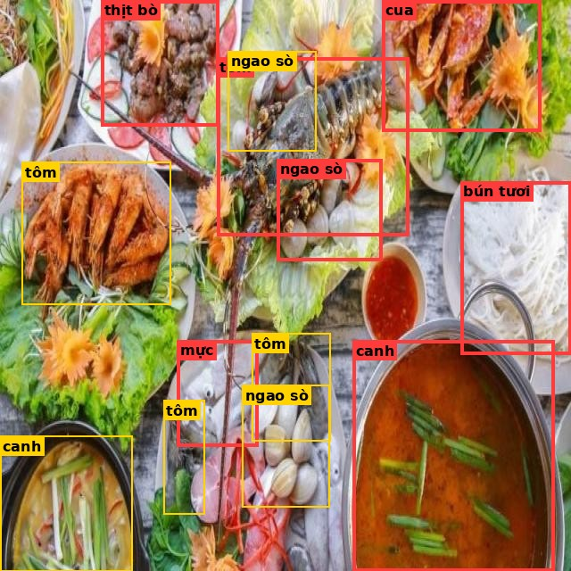
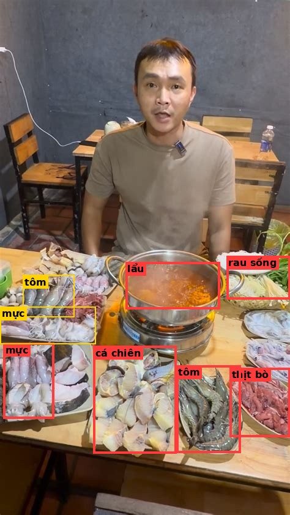
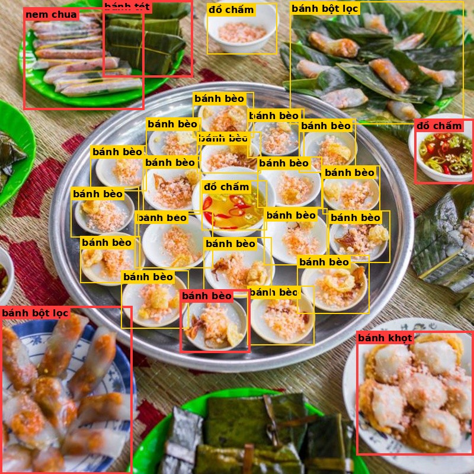
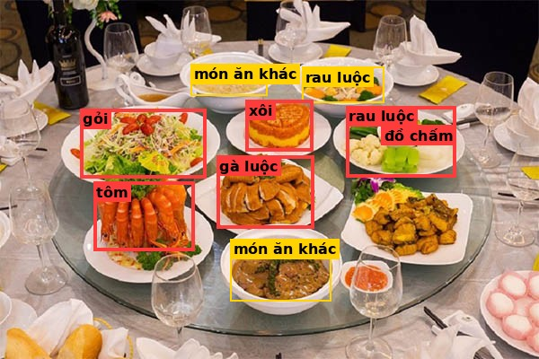
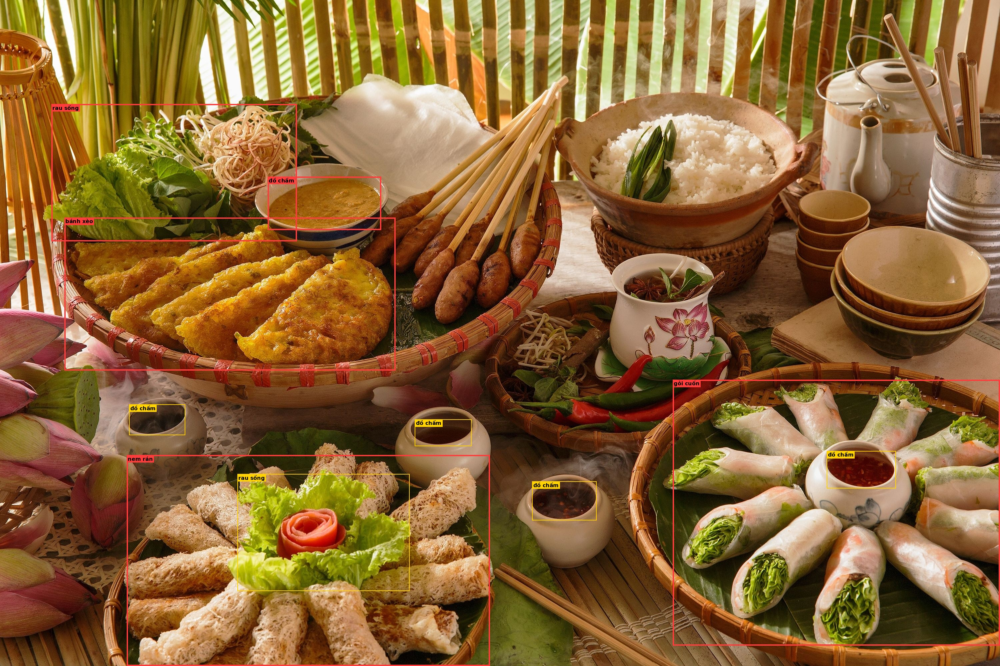

# Ví dụ caption dài được VLM (Gemma 4 12B, 4-bit) sửa

Nguồn: `grounding_data/vifood54/vlm_attrs/train_gemma-4-12B-it_shard0of2.jsonl` (shard 0). 147 ảnh có ≥3 thay đổi; chọn 5 ảnh caption dài nhất, đa dạng món.

Box **đỏ** = crop gửi VLM (box lớn nhất mỗi món), vàng = box khác. Trong caption sửa: ~~gạch~~ = đặc điểm VLM không thấy, **đậm** = đặc điểm thay vào (VLM thấy).
Chỉ minh họa — chưa ghi vào dữ liệu train.

## 1. `srcA_H-011_jpg.rf.addf69245d81cf6c2805821b93e7b756.jpg`

**Caption gốc:**

> Hai tô canh nằm ở góc dưới bên trái và góc dưới bên phải. Rải rác trên bàn có bốn phần tôm, thân cong màu cam đỏ. Góc trên bên phải là một con cua, đặt nguyên con trên đĩa. Bên phải là một phần bún tươi, mặt sợi trắng mịn. Ở góc trên bên trái có một đĩa thịt bò, xào với hành tây. Rải rác trên bàn có ba phần ngao sò, vỏ hai mảnh màu trắng xám. Ở phía dưới có một đĩa mực, khoanh tròn hoặc nguyên con.

**Thay đổi:**

> Hai tô canh nằm ở góc dưới bên trái và góc dưới bên phải. Rải rác trên bàn có bốn phần tôm, ~~thân cong màu cam đỏ~~ **vỏ bóng**. Góc trên bên phải là một con cua, ~~đặt nguyên con trên đĩa~~ **mai màu đỏ cam**. Bên phải là một phần bún tươi, ~~mặt sợi trắng mịn~~ **sợi nhỏ màu trắng**. Ở góc trên bên trái có một đĩa thịt bò, ~~xào với hành tây~~ **lát thịt màu nâu đỏ**. Rải rác trên bàn có ba phần ngao sò, vỏ hai mảnh màu trắng xám. Ở phía dưới có một đĩa mực, khoanh tròn hoặc nguyên con.

**Caption sau sửa:**

> Hai tô canh nằm ở góc dưới bên trái và góc dưới bên phải. Rải rác trên bàn có bốn phần tôm, vỏ bóng. Góc trên bên phải là một con cua, mai màu đỏ cam. Bên phải là một phần bún tươi, sợi nhỏ màu trắng. Ở góc trên bên trái có một đĩa thịt bò, lát thịt màu nâu đỏ. Rải rác trên bàn có ba phần ngao sò, vỏ hai mảnh màu trắng xám. Ở phía dưới có một đĩa mực, khoanh tròn hoặc nguyên con.

| Món | VLM: đúng món? | Đặc điểm VLM thấy | VLM thêm | Đựng trong |
|---|---|---|---|---|
| mực | có | thân màu trắng hồng, khoanh tròn hoặc nguyên con | có râu, màu trắng | không rõ |
| thịt bò | có | lát thịt màu nâu đỏ, thái mỏng, vân mỡ trắng | trang trí hoa quả, lát cà chua | đĩa |
| cua | có | mai màu đỏ cam | có lá xanh, màu sắc sặc sỡ | không rõ |
| canh | có | rau lá xanh trong nước, mặt nước điểm hành lá | nước màu cam, nồi kim loại | nồi |
| tôm | không | vỏ bóng | có vỏ cứng, màu xám nâu | lá |
| ngao sò | có | vỏ hai mảnh màu trắng xám, vỏ có gân sọc, mở miệng lộ thịt bên trong | nằm trên lá, có màu đỏ | lá |
| bún tươi | có | sợi nhỏ màu trắng, đặt riêng trên đĩa | có rau xanh, có nước sốt | đĩa |

## 2. `lau_detail_00017.jpg`

**Caption gốc:**

> Một phần cá chiên nằm ở phía dưới, vây và đuôi còn nguyên. Ở bên trái và góc dưới bên phải có hai con tôm, râu dài. Chính giữa là một nồi lẩu, nhiều rau và nguyên liệu nổi trên mặt, nồi kim loại. Ở góc dưới bên phải có một đĩa thịt bò, vân mỡ trắng, thái mỏng. Ở bên trái và góc dưới bên trái có hai phần mực, râu dài cong, xào với hành và ớt. Bên phải là một đĩa rau sống nhỏ, nhiều loại lá.

**Thay đổi:**

> Một phần cá chiên nằm ở phía dưới, ~~vây và đuôi còn nguyên~~ **nguyên con hoặc cắt khúc**. Ở bên trái và góc dưới bên phải có hai con tôm, ~~râu dài~~ **vỏ bóng**. Chính giữa là một nồi lẩu, nhiều rau và nguyên liệu nổi trên mặt, nồi kim loại. Ở góc dưới bên phải có một đĩa thịt bò, vân mỡ trắng, thái mỏng. Ở bên trái và góc dưới bên trái có hai phần mực, ~~râu dài cong~~ **thân màu trắng hồng**, ~~xào với hành và ớt~~ **khoanh tròn hoặc nguyên con**. Bên phải là một đĩa rau sống nhỏ, nhiều loại lá.

**Caption sau sửa:**

> Một phần cá chiên nằm ở phía dưới, nguyên con hoặc cắt khúc. Ở bên trái và góc dưới bên phải có hai con tôm, vỏ bóng. Chính giữa là một nồi lẩu, nhiều rau và nguyên liệu nổi trên mặt, nồi kim loại. Ở góc dưới bên phải có một đĩa thịt bò, vân mỡ trắng, thái mỏng. Ở bên trái và góc dưới bên trái có hai phần mực, thân màu trắng hồng, khoanh tròn hoặc nguyên con. Bên phải là một đĩa rau sống nhỏ, nhiều loại lá.

| Món | VLM: đúng món? | Đặc điểm VLM thấy | VLM thêm | Đựng trong |
|---|---|---|---|---|
| mực | không chắc | thân màu trắng hồng, khoanh tròn hoặc nguyên con | có vảy, mặt bóng | khay |
| tôm | có | vỏ bóng, xếp nhiều con trên đĩa | màu xám xanh, thân dài | đĩa |
| lẩu | có | nước dùng màu đỏ cam hoặc trong, nhiều rau và nguyên liệu nổi trên mặt, nồi kim loại | hơi nước bốc lên, thành nồi màu bạc | nồi |
| thịt bò | có | lát thịt màu nâu đỏ, thái mỏng, vân mỡ trắng | lớp màng bọc, màu hồng nhạt | khay |
| rau sống | có | nhiều loại lá, lẫn giá đỗ trắng, lá xanh đậm và xanh nhạt | có nắp đậy, màu trắng chủ đạo | nồi |
| cá chiên | không | nguyên con hoặc cắt khúc | màu trắng xám, hình dạng không đều | đĩa |

## 3. `banh_beo_detail_00019.jpg`

**Caption gốc:**

> Hai phần bánh bột lọc nằm ở góc trên bên phải và góc dưới bên trái, miếng dẹt hình chữ nhật. Ở góc dưới bên phải có một phần bánh khọt, bánh tròn nhỏ màu vàng. Một phần nem chua nằm ở góc trên bên trái, bọc lá chuối xanh. Góc trên bên trái là một phần bánh tét, hình trụ dài. Rải rác trên bàn có nhiều chén bánh bèo, điểm mỡ hành xanh. Ba bát nhỏ đồ chấm nằm rải rác trên bàn, lẫn tỏi băm.

**Thay đổi:**

> Hai phần bánh bột lọc nằm ở góc trên bên phải và góc dưới bên trái, miếng dẹt hình chữ nhật. Ở góc dưới bên phải có một phần bánh khọt, ~~bánh tròn nhỏ màu vàng~~ **viền vàng nâu**. Một phần nem chua nằm ở góc trên bên trái, bọc lá chuối xanh. Góc trên bên trái là một phần bánh tét, hình trụ dài. Rải rác trên bàn có nhiều chén bánh bèo, ~~điểm mỡ hành xanh~~ **lớp bột trắng mỏng**. Ba bát nhỏ đồ chấm nằm rải rác trên bàn, ~~lẫn tỏi băm~~ **nước màu nâu đỏ hoặc vàng**.

**Caption sau sửa:**

> Hai phần bánh bột lọc nằm ở góc trên bên phải và góc dưới bên trái, miếng dẹt hình chữ nhật. Ở góc dưới bên phải có một phần bánh khọt, viền vàng nâu. Một phần nem chua nằm ở góc trên bên trái, bọc lá chuối xanh. Góc trên bên trái là một phần bánh tét, hình trụ dài. Rải rác trên bàn có nhiều chén bánh bèo, lớp bột trắng mỏng. Ba bát nhỏ đồ chấm nằm rải rác trên bàn, nước màu nâu đỏ hoặc vàng.

| Món | VLM: đúng món? | Đặc điểm VLM thấy | VLM thêm | Đựng trong |
|---|---|---|---|---|
| bánh bèo | có | lớp bột trắng mỏng, rắc ruốc màu cam | màu cam rực, hình tròn nhỏ | chén |
| bánh bột lọc | có | vỏ bột trong suốt, lộ nhân màu cam đỏ bên trong, miếng dẹt hình chữ nhật | màu cam nổi bật | đĩa |
| đồ chấm | có | nước màu nâu đỏ hoặc vàng, lát ớt đỏ nổi trên mặt | lát ớt xanh, nước trong | chén |
| bánh khọt | không chắc | viền vàng nâu, mặt bánh điểm nhân màu cam hồng, xếp nhiều cái sát nhau | mặt trắng mịn, hình tròn dẹt | đĩa |
| bánh tét | có | hình trụ dài, bọc lá chuối buộc lạt ngang | màu xanh lá, dây buộc vàng | khay |
| nem chua | có | bọc lá chuối xanh, khối nhỏ hình chữ nhật, mặt cắt màu hồng đỏ | lớp màng bọc, đĩa màu xanh | đĩa |

## 4. `thuc-don-tiec-tat-nien-cong-ty.jpg`

**Caption gốc:**

> Bên trái là một đĩa gỏi, rắc lạc rang. Hai phần rau luộc nằm ở phía trên và bên phải, xếp gọn trên đĩa. Ở chính giữa có một đĩa gà luộc, chặt miếng xếp trên đĩa, thịt trắng ở mặt cắt. Một phần tôm nằm ở bên trái, râu dài. Ở phía trên và phía dưới có hai món ăn khác. Chính giữa là một đĩa xôi nhỏ, đắp thành đĩa hoặc nắm. Một chén đồ chấm nhỏ nằm ở bên phải, nước màu nâu đỏ hoặc vàng.

**Thay đổi:**

> Bên trái là một đĩa gỏi, ~~rắc lạc rang~~ **trộn lá rau xanh**. Hai phần rau luộc nằm ở phía trên và bên phải, xếp gọn trên đĩa. Ở chính giữa có một đĩa gà luộc, chặt miếng xếp trên đĩa, thịt trắng ở mặt cắt. Một phần tôm nằm ở bên trái, ~~râu dài~~ **thân cong màu cam đỏ**. Ở phía trên và phía dưới có hai món ăn khác. Chính giữa là một đĩa xôi nhỏ, ~~đắp thành đĩa hoặc nắm~~ **hạt nếp màu trắng hoặc vàng**. Một chén đồ chấm nhỏ nằm ở bên phải, nước màu nâu đỏ hoặc vàng.

**Caption sau sửa:**

> Bên trái là một đĩa gỏi, trộn lá rau xanh. Hai phần rau luộc nằm ở phía trên và bên phải, xếp gọn trên đĩa. Ở chính giữa có một đĩa gà luộc, chặt miếng xếp trên đĩa, thịt trắng ở mặt cắt. Một phần tôm nằm ở bên trái, thân cong màu cam đỏ. Ở phía trên và phía dưới có hai món ăn khác. Chính giữa là một đĩa xôi nhỏ, hạt nếp màu trắng hoặc vàng. Một chén đồ chấm nhỏ nằm ở bên phải, nước màu nâu đỏ hoặc vàng.

| Món | VLM: đúng món? | Đặc điểm VLM thấy | VLM thêm | Đựng trong |
|---|---|---|---|---|
| gà luộc | có | da màu vàng nhạt, chặt miếng xếp trên đĩa, thịt trắng ở mặt cắt | lớp da bóng, lá xanh trang trí | đĩa |
| rau luộc | có | xếp gọn trên đĩa, màu xanh thẫm | súp lơ trắng, cà rốt cắt khúc | đĩa |
| gỏi | có | trộn lá rau xanh, sợi cà rốt và ớt đỏ | nhiều màu sắc, hình tròn | đĩa |
| đồ chấm | có | nước màu nâu đỏ hoặc vàng | màu vàng cam, bề mặt lỏng | chén |
| tôm | có | thân cong màu cam đỏ, vỏ bóng, xếp nhiều con trên đĩa | lớp rau xanh, màu cam rực | đĩa |
| xôi | không | hạt nếp màu trắng hoặc vàng | hình trái tim, lớp kem vàng | đĩa |

## 5. `mon_an_khac_multi_dish_00246.jpg`

**Caption gốc:**

> Ở góc dưới bên phải có một đĩa gỏi cuốn, vỏ trong mờ, lộ màu hồng cam và lá xanh bên trong. Ở góc dưới bên trái có một phần nem rán, cắt khúc. Ở bên trái có một phần bánh xèo, mép bánh vàng nâu, lộ giá đỗ trắng bên trong. Ở góc trên bên trái và góc dưới bên trái có hai đĩa rau sống, xếp đầy kín. Rải rác trên bàn có năm chén đồ chấm, nước màu nâu đỏ hoặc vàng, lẫn tỏi băm.

**Thay đổi:**

> Ở góc dưới bên phải có một đĩa gỏi cuốn, vỏ trong mờ, lộ màu hồng cam và lá xanh bên trong. Ở góc dưới bên trái có một phần nem rán, ~~cắt khúc~~ **cuốn dài màu vàng nâu**. Ở bên trái có một phần bánh xèo, mép bánh vàng nâu, ~~lộ giá đỗ trắng bên trong~~ **bánh mỏng màu vàng nghệ**. Ở góc trên bên trái và góc dưới bên trái có hai đĩa rau sống, ~~xếp đầy kín~~ **nhiều loại lá**. Rải rác trên bàn có năm chén đồ chấm, nước màu nâu đỏ hoặc vàng, ~~lẫn tỏi băm~~ **nước sệt**.

**Caption sau sửa:**

> Ở góc dưới bên phải có một đĩa gỏi cuốn, vỏ trong mờ, lộ màu hồng cam và lá xanh bên trong. Ở góc dưới bên trái có một phần nem rán, cuốn dài màu vàng nâu. Ở bên trái có một phần bánh xèo, mép bánh vàng nâu, bánh mỏng màu vàng nghệ. Ở góc trên bên trái và góc dưới bên trái có hai đĩa rau sống, nhiều loại lá. Rải rác trên bàn có năm chén đồ chấm, nước màu nâu đỏ hoặc vàng, nước sệt.

| Món | VLM: đúng món? | Đặc điểm VLM thấy | VLM thêm | Đựng trong |
|---|---|---|---|---|
| đồ chấm | có | nước màu nâu đỏ hoặc vàng | nước sệt, bát có sọc | bát |
| bánh xèo | không | bánh mỏng màu vàng nghệ, gấp đôi hình bán nguyệt, mép bánh vàng nâu | lớp vỏ vàng, lá xà lách xanh | rổ |
| rau sống | có | nhiều loại lá, lẫn giá đỗ trắng, lá xanh đậm và xanh nhạt | có sợi trắng, có nước chấm | rổ |
| gỏi cuốn | có | vỏ trong mờ, lộ màu hồng cam và lá xanh bên trong, cuộn dài hình trụ | nước chấm đỏ, lót lá xanh | mẹt |
| nem rán | có | cuốn dài màu vàng nâu, vỏ phồng rộp | lớp lá xanh, hoa cà rốt | mẹt |
