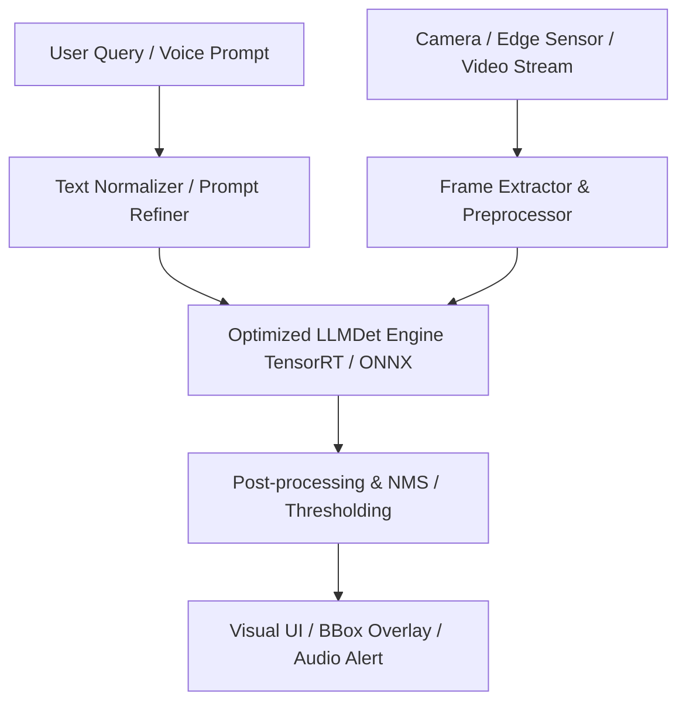
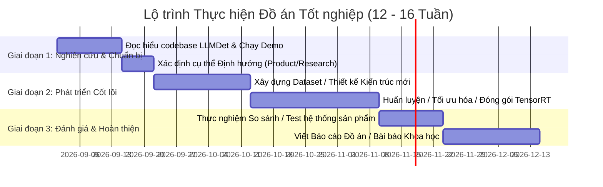

# BÁO CÁO PHÂN TÍCH CHUYÊN SÂU KIẾN TRÚC LLMDET VÀ ĐỊNH HƯỚNG PHÁT TRIỂN ĐỒ ÁN TỐT NGHIỆP

---

## 1. TỔNG QUAN VỀ LLMDET VÀ BỐI CẢNH NGÀNH (STATE-OF-THE-ART)

### 1.1. Bối cảnh bài toán Open-Vocabulary Object Detection (OV-OD)
Phát hiện đối tượng từ vựng mở (Open-Vocabulary Object Detection - OV-OD) là bước tiến quan trọng vượt khỏi giới hạn của mô hình phát hiện đối tượng truyền thống (chỉ nhận diện được cố định $N$ lớp trong COCO/VOC). OV-OD cho phép mô hình nhận diện bất kỳ đối tượng nào thông qua mô tả văn bản tự do (text prompt).

Các mô hình tiền nhiệm chính:
* **GLIP / Grounding DINO**: Căn chỉnh ngữ nghĩa giữa vùng ảnh (region feature) và từ khóa (text feature từ BERT) thông qua cơ chế Cross-Attention. Hạn chế: Chỉ học trên các nhãn ngắn (short labels/phrases), thiếu khả năng hiểu ngữ cảnh tổng thể sâu sắc của toàn bộ bức ảnh.
* **YOLO-World**: Tối ưu tốc độ realtime cho OV-OD bằng cách tái cấu trúc rep-param text encoder, nhưng hạn chế ở các truy vấn phức tạp (complex referential expressions).
* **LLaVA / Qwen-VL (MLLMs)**: Có khả năng hiểu hình ảnh và ngữ cảnh cực mạnh, nhưng xử lý bounding box còn kém, tốc độ chậm và tốn GPU.

### 1.2. Đột phá của LLMDet (CVPR 2025 Highlight)
LLMDet giải quyết khoảng cách giữa **Mô hình phát hiện đối tượng (Grounding DINO)** và **Mô hình ngôn ngữ đa phương thức (MLLMs - LLaVA/Qwen)** bằng ý tưởng: **"Dùng MLLM giám sát và nâng cao năng lực cho Object Detector"**.

#### Cơ chế hoạt động cốt lõi của LLMDet:
1. **Co-Training với MLLM**:
   * Detector (Grounding DINO) vừa học hàm mất mát Grounding tiêu chuẩn ($L_{cls} + L_{bbox}$), vừa truyền feature map ($P_4, P_5$) và Object Queries qua Projector kết nối vào MLLM (LLaVA-Qwen2).
2. **Hàm mất mát kép (Dual Caption Supervision)**:
   * **Image-level Loss ($L_{image\_cap}$)**: Ép các feature map của Detector chứa đựng tri thức toàn cục (global semantic representation) để MLLM có thể sinh ra Long Caption mô tả chi tiết ảnh.
   * **Region-level Loss ($L_{region\_cap}$)**: Ép các Object Query của DETR Decoder chứa thông tin vùng mịn (fine-grained region details) để MLLM sinh ra Short Caption cho từng ROI.
3. **Ưu điểm lớn nhất**: Khi huấn luyện xong, trong quá trình suy luận (Inference), mô hình có thể **bỏ MLLM đi** (Set `lmm=None`), chỉ chạy Grounding DINO nhưng đạt hiệu năng vượt trội so với Grounding DINO gốc nhờ đặc trưng ảnh đã được làm giàu bởi MLLM.

---

## 2. PHÂN TÍCH ƯU ĐIỂM, NHƯỢC ĐIỂM VÀ ĐIỂM NGHẼN (BOTTLENECK) CỦA LLMDET

| Tiêu chí | Điểm mạnh (Strengths) | Điểm yếu / Điểm nghẽn (Bottlenecks) |
| :--- | :--- | :--- |
| **Năng lực nhận diện** | Hiệu năng vượt trội trên LVIS (Zero-Shot AP cao), nhận diện cực tốt các từ hiếm (rare classes) và câu mô tả dài (referential expressions). | Phụ thuộc vào chất lượng tập dữ liệu sinh bởi MLLM (GroundingCap-1M). Nếu MLLM bị ảo giác (hallucination), detector sẽ bị nhiễu. |
| **Kiến trúc suy luận** | Dễ dàng tách rời LLM lúc inference, tốc độ suy luận bằng với Grounding DINO thông thường. | Tốc độ suy luận của Grounding DINO (Swin + BERT + Deformable DETR 6 layers) vẫn **chưa đủ nhanh cho các thiết bị Edge/Real-time** (chỉ đạt ~15-25 FPS trên GPU V100/RTX 3090). |
| **Chi phí huấn luyện** | Học được cả chi tiết vùng và tri thức ngữ cảnh toàn cục nhờ Dual-Caption Loss. | **Rất tốn tài nguyên huấn luyện**: Cần chạy đồng thời Swin Backbones, BERT, DETR Transformer và Qwen2-0.5B/7B LLM (cần GPU VRAM lớn > 24GB-80GB, DeepSpeed ZeRO-3). |
| **Khả năng định vị (Localization)** | Kết hợp giữa Feature Map trích xuất đa tỉ lệ (P4, P5) và Dense Object Queries. | Bounding box chưa tối ưu cho các vật thể cực nhỏ hoặc cực kỳ dày đặc (dense small objects) trong ảnh độ phân giải cao. |

---

## 3. ĐỊNH HƯỚNG 1: HƯỚNG SẢN PHẨM & ỨNG DỤNG THỰC TẾ (PRODUCT ORIENTATION)

Nếu chọn hướng Sản phẩm, mục tiêu là giải quyết một bài toán thực tế chưa có giải pháp tốt, biến LLMDet thành một hệ thống/ứng dụng chạy ổn định, tối ưu chi phí và tạo giá trị thực sự.

### 3.1. Các thực trạng & Bài toán thực tế tiềm năng (Use Cases)

#### 🏭 Bài toán 1: Kiểm tra lỗi sản phẩm tự động trong công nghiệp (Industrial Quality Control / Defect Detection)
* **Thực trạng**: Các dây chuyền sản xuất (điện tử, may mặc, cơ khí) thường xuyên xuất hiện các loại lỗi mới (new defect types). Việc gán nhãn hàng nghìn ảnh cho mỗi loại lỗi mới là vô cùng đắt đỏ và tốn thời gian.
* **Giải pháp với LLMDet**: Sử dụng khả năng Zero-Shot OV-OD của LLMDet. Người vận hành chỉ cần gõ văn bản mô tả lỗi (ví dụ: *"scratch on metal edge"*, *"missing solder joint"*, *"stained fabric area"*) là mô hình có thể phát hiện ngay mà không cần train lại.
* **Định hướng nâng cấp**: Tích hợp module **Domain Adapter** nhỏ để tinh chỉnh mô hình với ít mẫu (Few-shot prompt tuning), đảm bảo độ chính xác >98% với độ trễ thấp.

#### 🌾 Bài toán 2: Nông nghiệp thông minh – Phát hiện sâu bệnh & Cỏ dại linh hoạt (Smart Agriculture)
* **Thực trạng**: Các mô hình AI trong nông nghiệp bị giới hạn bởi danh mục cố định. Khi gặp loại dịch bệnh mới hoặc giống cây mới, mô hình cũ bị thất bại.
* **Giải pháp với LLMDet**: Cho phép kỹ sư nông nghiệp hoặc nông dân nhập mô tả triệu chứng bệnh bằng ngôn ngữ tự nhiên (ví dụ: *"yellow spots on tomato leaf"*, *"curled brown leaves"*) để phát hiện và định vị chính xác vị trí bệnh trên cánh đồng qua ảnh Drone.

#### 🚑 Bài toán 3: Trợ lý thị giác thông minh cho người khiếm thị / Kính AR (Assistive Visual AI)
* **Thực trạng**: Người khiếm thị cần tìm các vật dụng cá nhân nhỏ (ví dụ: *"chùm chìa khóa màu đỏ trên bàn"*, *"hộp thuốc màu xanh trên kệ"*). Các ứng dụng hiện tại chỉ đọc được các nhãn chung chung như *"bottle"*, *"keys"*.
* **Giải pháp với LLMDet**: Sử dụng khả năng Phrase Grounding & Referential Expression Comprehension của LLMDet để tìm đúng vật thể cụ thể được mô tả bởi người dùng thông qua giọng nói.

### 3.2. Yêu cầu kỹ thuật để thương mại hóa (Product Pipeline Architecture)
Để đưa LLMDet vào sản phẩm thực tế, bạn cần xây dựng hệ thống như sau:

#### Các bước tối ưu hóa kỹ thuật cho đồ án Hướng Sản phẩm:
1. **Đóng gói TensorRT / ONNX**: Chuyển đổi mô hình LLMDet (phần Detector) sang TensorRT để tăng tốc độ suy luận từ 20 FPS lên **60-100 FPS** trên GPU NVIDIA (hoặc ONNX Runtime cho CPU/Edge devices).
2. **Xây dựng Web/Mobile App hoàn chỉnh**:
   * Backend: FastAPI / Triton Inference Server hỗ trợ luồng TensorRT.
   * Frontend: React / Next.js / Flutter hiển thị Bounding Box realtime trên luồng Camera Video.
3. **Thử nghiệm & Đánh giá (Benchmark)**: Đánh giá độ trễ (Latency), dung lượng bộ nhớ (VRAM/RAM Usage) và độ chính xác (mAP) trên tập dữ liệu thực tế thu thập được.

---

## 4. ĐỊNH HƯỚNG 2: HƯỚNG NGHIÊN CỨU & CẢI TIẾN KỸ THUẬT (RESEARCH ORIENTATION)

Nếu chọn hướng Nghiên cứu, mục tiêu là tìm ra các điểm yếu chuyên sâu của LLMDet, đề xuất cải tiến về mặt toán học / kiến trúc, thực hiện thực nghiệm so sánh (Ablation Study) và công bố bài báo (Conference/Journal).

### 4.1. Đề xuất Nghiên cứu 1: **LLMDet-Lite / RT-LLMDet** (Nghiên cứu Chưng cất Tri thức & Tối ưu hóa Realtime)
* **Vấn đề của LLMDet**: Mặc dù loại bỏ LMM khi suy luận, phần Detector (Grounding DINO với Swin-T + BERT) vẫn có dung lượng khoảng ~170M - 400M tham số, cấu trúc Deformable DETR 6 lớp decoder khá nặng, chưa thể đạt Real-time (≥60 FPS) trên thiết bị nhúng.
* **Ý tưởng nghiên cứu**:
  * Thay thế Backbone Swin-Transformer và Deformable DETR bằng kiến trúc **YOLO-World** hoặc **RT-DETR** (Real-Time DETR).
  * Áp dụng **Cross-Model Knowledge Distillation**: Sử dụng LLMDet bản lớn (Swin-L + Qwen2) làm **Teacher Model**, chưng cất tri thức (Feature Distillation + Logit Distillation) sang mô hình **Student Light-weight** (như RT-DETR-ResNet18 hoặc YOLO-World-Small).
* **Đóng góp khoa học (Novelty)**:
  * Đề xuất phương pháp chưng cất đặc trưng đa ngữ nghĩa (Multi-modal Feature Distillation) từ MLLM Supervision xuống Real-time Detectors.
  * Tạo ra mô hình đạt SOTA về trade-off giữa **Tốc độ (FPS > 100)** và **Độ chính xác Open-Vocabulary**.

### 4.2. Đề xuất Nghiên cứu 2: **Continuous Video Open-Vocabulary Grounding** (Mở rộng từ Ảnh tĩnh sang Video)
* **Vấn đề của LLMDet**: LLMDet hiện tại chỉ hoạt động trên ảnh tĩnh 2D ($I \in \mathbb{R}^{H \times W \times 3}$). Trong thực tế, các truy vấn thường ở dạng video (ví dụ: *"người mặc áo đỏ xuất hiện ở phút thứ 2 và đi vào cửa"*).
* **Ý tưởng nghiên cứu**:
  * Mở rộng LLMDet thành **LLMDet-Video**.
  * Tích hợp thêm **Temporal Attention Module** hoặc **3D Query Interaction** để theo dõi (track) và định vị không-thời gian (Spatio-Temporal Grounding) cho các đối tượng từ vựng mở trong chuỗi video.
* **Đóng góp khoa học (Novelty)**:
  * Xây dựng cơ chế co-training giữa MLLM Video (như LLaVA-Video / Video-ChatGPT) và Video Object Grounding Detector.

### 4.3. Đề xuất Nghiên cứu 3: **LLMDet-SAM Fusion** (Tích hợp Grounded Object Detection với Open-Vocabulary Instance Segmentation)
* **Vấn đề của LLMDet**: LLMDet chỉ dự đoán **Bounding Box** (hộp chữ nhật), không dự đoán được **Mask** (phân đoạn mặt nạ chính xác từng pixel).
* **Ý tưởng nghiên cứu**:
  * Tích hợp linh hoạt feature từ LLMDet vào mô hình **Segment Anything 2 (SAM 2)** hoặc **HQ-SAM**.
  * Thiết kế lớp **Prompt Bridge Layer** để biến các Object Query giàu tri thức của LLMDet thành Visual Prompts trực tiếp cho SAM 2 Mask Decoder.
* **Đóng góp khoa học (Novelty)**:
  * Tạo ra mô hình **Open-Vocabulary Grounded Instance Segmentation** đạt hiệu năng SOTA mà không cần huấn luyện lại toàn bộ SAM 2.

### 4.4. Đề xuất Nghiên cứu 4: **Lọc Ảo giác & Nâng cao Chất lượng Caption Supervision (De-Hallucinated Co-Training)**
* **Vấn đề của LLMDet**: Bộ dữ liệu GroundingCap-1M sử dụng MLLM để tự động sinh caption. MLLM thường mắc lỗi **Hallucination** (mô tả đối tượng không hề có trong ảnh). Khi dùng caption ảo giác này làm Supervision Loss, Detector bị học sai đặc trưng (false positive).
* **Ý tưởng nghiên cứu**:
  * Phát triển cơ chế **Uncertainty-Aware Loss** hoặc **DPO (Direct Preference Optimization)** dành cho MLLM Supervision.
  * Tích hợp module lọc nhiễu tự động (Confidence Filtering Module) để đo đạc mức độ tin cậy giữa Bounding Box và Caption trước khi tính $L_{image\_cap}$ và $L_{region\_cap}$.

---

## 5. BẢNG SO SÁNH LỰA CHỌN ĐỊNH HƯỚNG ĐỒ ÁN TỐT NGHIỆP

| Tiêu chí | Hướng 1: SẢN PHẨM (Product / Engineering) | Hướng 2: NGHIÊN CỨU (Research / Academic) |
| :--- | :--- | :--- |
| **Mục tiêu đầu ra** | - Hệ thống/Ứng dụng Web/Mobile/Edge hoạt động mượt mà. - Mã nguồn mở đóng gói TensorRT/Docker. - Báo cáo kỹ thuật chi tiết. | - Bài báo khoa học (gửi hội nghị như KSE, ACIIDS, RIVF hoặc tạp chí IEEE/Elsevier). - Mã nguồn mô hình cải tiến trên GitHub. - Báo cáo thực nghiệm so sánh (Ablation). |
| **Khối lượng công việc chính** | - Tối ưu hóa mô hình (TensorRT / ONNX / Quantization FP16/INT8). - Thiết kế hệ thống Backend (FastAPI/Triton), Frontend. - Thu thập và gán nhãn tập dữ liệu thực tế nhỏ để test. | - Đề xuất phương pháp/kiến trúc mới (Math/Loss/Architecture). - Huấn luyện và thực nghiệm so sánh trên các tập benchmark chuẩn (COCO, LVIS, Flickr30k). |
| **Tài nguyên GPU yêu cầu** | **Thấp - Trung bình**: Chỉ cần GPU để chạy Inference và fine-tune nhẹ (1x RTX 3090 / RTX 4090 hoặc Google Colab Pro là đủ). | **Trung bình - Cao**: Cần GPU để huấn luyện lại/chưng cất mô hình (Tối thiểu 1-2x A100 40GB/80GB hoặc GPU RTX 4090 tương đương). |
| **Độ rủi ro (Risk)** | **Thấp**: Rõ ràng về mặt công nghệ, chủ yếu phụ thuộc vào kỹ năng lập trình hệ thống và tối ưu phần mềm. | **Trung bình - Cao**: Cần kiểm chứng xem ý tưởng cải tiến có thực sự làm tăng chỉ số mAP/FPS hơn baseline hay không. |
| **Tính ứng dụng tuyển dụng** | Rất cao cho vị trí **AI Engineer, MLOps Engineer, Computer Vision Engineer**. | Rất cao cho vị trí **AI Researcher, Data Scientist, hoặc học tiếp Master/PhD**. |

---

## 6. LỘ TRÌNH THỰC HIỆN CHI TIẾT (STEP-BY-STEP ROADMAP)

Dù bạn chọn hướng nào, lộ trình 12-16 tuần làm đồ án tốt nghiệp đề xuất như sau:

### 🎯 Khuyên dùng từ Chuyên gia:
1. **Nếu bạn có tài nguyên GPU hạn chế và muốn làm sản phẩm thực tế có tính ứng dụng cao**:
   👉 **Chọn Hướng 1.1 (Industrial QA)** hoặc **Hướng 1.3 (Trợ lý người khiếm thị)**. Tập trung chuyển đổi LLMDet sang **TensorRT INT8/FP16**, kết hợp với **FastAPI + React Native / Next.js**, xây dựng giải pháp End-to-End hoàn chỉnh.

2. **Nếu bạn có tài nguyên GPU tốt và muốn làm nghiên cứu để học tiếp hoặc làm R&D**:
   👉 **Chọn Hướng 2.1 (RT-LLMDet via Knowledge Distillation)** hoặc **Hướng 2.3 (LLMDet-SAM Fusion)**. Ý tưởng chưng cất tri thức từ LLMDet sang mô hình Realtime là một hướng cực kỳ thời sự (hot topic) trong cộng đồng Computer Vision hiện nay.

---
*Báo cáo được tổng hợp và phân tích dựa trên toàn bộ mã nguồn LLMDet, bài báo gốc CVPR 2025 và xu hướng SOTA Multimodal AI năm 2025-2026.*
