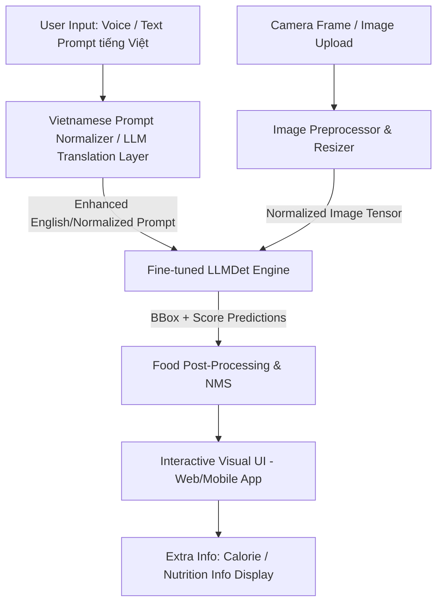

# BÁO CÁO PHÂN TÍCH VÀ KẾ HOẠCH TRIỂN KHAI THỰC TẾ
## ỨNG DỤNG LLMDET VÀO BÀI TOÁN PHÁT HIỆN VÀ ĐỊNH VỊ MÓN ĂN VIỆT NAM (VIETNAMESE CUISINE GROUNDING)

---

## 1. TỔNG QUAN Ý TƯỞNG VÀ ĐÁNH GIÁ ĐỘ KHẢ THI (FEASIBILITY ANALYSIS)

### 1.1. Khái quát Bài toán & Giá trị Đồ án (Value Proposition)
* **Ý tưởng**: Xây dựng ứng dụng thị giác máy tính cho phép nhận diện và khoanh vùng chính xác vị trí của các món ăn Việt Nam trên bàn ăn (mâm cơm gia đình, tiệc buffet, nhà hàng, quán ăn đường phố) thông qua mô tả ngôn ngữ tự nhiên (Text Prompt / Voice Prompt).
* **Ví dụ thực tế**:
  * Prompt: `"bún chả Hà Nội"` $\rightarrow$ Mô hình chỉ định vị đúng đĩa bún chả, không nhầm với đĩa nem hay đĩa rau sống.
  * Prompt: `"bát phở bò nhiều hành"` $\rightarrow$ Mô hình tìm đúng bát phở bò có thuộc tính "nhiều hành".
  * Prompt: `"món nào là đồ chay?"` hoặc `"món ăn chứa đậu phụ"` $\rightarrow$ Mô hình áp dụng reasoning của LLM để khoanh vùng đĩa đậu lướt ván / đậu sốt cà chua.

### 1.2. Phân tích độ khả thi (Feasibility Matrix)

1. **Khả thi về mặt Kỹ thuật & Mô hình (Technical Feasibility): ⭐⭐⭐⭐⭐ (5/5)**
   * **Bản chất LLMDet**: Được huấn luyện trên GroundingCap-1M với MLLM supervision, LLMDet vừa hiểu đặc trưng vùng (region features) vừa hiểu mô tả tự nhiên mịn (fine-grained attributes: màu sắc, nguyên liệu, cách chế biến).
   * **Khả năng Zero-Shot & Few-Shot**: LLMDet vượt trội ở bài toán nhận diện đối tượng theo ngữ cảnh và đặc tả chi tiết. Rất phù hợp với món ăn Việt Nam vốn có sự đa dạng về trình bày và nhiều thành phần kết hợp trong 1 đĩa/bát.

2. **Khả thi về mặt Ngôn ngữ & Tên gọi Việt Nam (Semantic/Linguistic Feasibility): ⭐⭐⭐⭐☆ (4/5)**
   * LLMDet gốc dùng BERT (`bert-base-uncased`) hoặc tokenizer tiếng Anh. Để xử lý tên món ăn Việt Nam (tiếng Việt có dấu / không dấu / từ địa phương), có 2 giải pháp cực kỳ đơn giản:
     * *Giải pháp A*: Dùng **Translating Prompt Layer** (hoặc LLM siêu nhỏ như PhoBERT/Qwen2-0.5B-Vietnamese) dịch prompt tiếng Việt tự nhiên sang tiếng Anh chi tiết trước khi đưa vào LLMDet (VD: *"Bún chả"* $\rightarrow$ *"Vietnamese grilled pork meatballs with rice noodles and fish sauce dipping"*).
     * *Giải pháp B*: Fine-tune nhẹ Text Encoder của LLMDet với từ điển món ăn Việt Nam / PhoBERT encoder.

3. **Khả thi về Dữ liệu (Data Feasibility): ⭐⭐⭐⭐☆ (4/5)**
   * Dữ liệu món ăn Việt Nam trên các tập open-source như Food-101, Vietnamese Food Dataset (VFOOD), VinAI Food Dataset... chủ yếu là **Classification** (ảnh chỉ có 1 món).
   * Tuy nhiên, với bài toán **Grounding/OD**, bạn không cần triệu ảnh. Chỉ cần **500 - 1.500 ảnh mâm cơm / bàn ăn đa dạng** (tích hợp 3-8 món/ảnh) được gán nhãn bounding box chuẩn theo định dạng ODVG/JSONL là đủ để fine-tune LLMDet đạt độ chính xác ấn tượng!

4. **Khả thi về Mặt Tính ứng dụng & Đánh giá Đồ án (Academic & Practical Value): ⭐⭐⭐⭐⭐ (5/5)**
   * **Tính thực tiễn cao**: Dễ làm Demo (Web App / Mobile App), tính trực quan cao khi thuyết minh với Hội đồng đồ án.
   * **Tính mới**: Các đồ án Food AI trước đây đa phần chỉ là bài toán *Classification* 1 đĩa đơn giản. Bài toán *Multi-object Food Grounding trên mâm cơm đa dạng món* ứng dụng LLMDet là một bước tiến hoàn toàn mới và ấn tượng.

---

## 2. CÁC THÁCH THỨC KỸ THUẬT CẦN GIẢI QUYẾT (CHALLENGES & BOTTLENECKS)

1. **Thách thức 1: Sự biến đổi hình dạng & Trình bày ẩm thực Việt (Visual Variance)**
   * *Hiện tượng*: Cùng là món "Phở bò", nhưng ở Hà Nội có quẩy, ở miền Nam có rau ôm/ngò gai; hoặc món "Bánh xèo" miền Tây to tròn còn bánh xèo miền Trung nhỏ gọn.
   * *Giải pháp*: Xây dựng prompt đa thuộc tính (attribute-rich prompts) kết hợp tính năng Fine-grained Grounding của LLMDet.

2. **Thách thức 2: Sự nhập nhằng ranh giới đĩa / bát và thành phần đi kèm (Boundary Ambiguity)**
   * *Hiện tượng*: Một suất Bún Chả bao gồm: 1 bát nước chấm thịt nướng + 1 đĩa bún + 1 rổ rau sống. Mô hình sẽ khoanh vùng từng bát/đĩa lẻ hay khoanh toàn bộ combo "Bún Chả"?
   * *Giải pháp*: Chuẩn hóa quy tắc gán nhãn (Annotation Protocol):
     * Nhãn cấp độ **Combo / Main Dish**: Khoanh toàn bộ cụm suất ăn.
     * Nhãn cấp độ **Sub-component**: Khoanh riêng từng món thành phần (ví dụ: `bun_cha_meat_bowl`, `rice_noodles`, `fresh_herbs`).

3. **Thách thức 3: Tiếng Việt có dấu và tên món đặc thù địa phương**
   * *Giải pháp*: Tích hợp module **Query Normalizer** sử dụng từ điển đồng nghĩa (Synonym Mapping Dictionary) hoặc LLM nhỏ để chuẩn hóa prompt người dùng nhập vào.

---

## 3. HƯỚNG DẪN XÂY DỰNG TẬP DỮ LIỆU (DATASET CONSTRUCTION - BƯỚC QUAN TRỌNG NHẤT)

Đây là phần cốt lõi quyết định 80% sự thành công của đồ án. Dưới đây là quy trình 4 bước xây dựng bộ dữ liệu **ViFood-Grounding-1K**:

### 3.1. Thu thập dữ liệu Ảnh (Image Collection Strategy)
* **Số lượng mục tiêu**: **800 - 1.500 ảnh chất lượng cao**.
* **Tiêu chí ảnh**:
  * Ảnh chứa **mâm cơm gia đình, bàn ăn nhà hàng, tiệc buffet, bàn ăn đường phố** (mỗi ảnh chứa từ 3 đến 8 món ăn khác nhau).
  * Đa dạng góc chụp: Top-down view (từ trên xuống), Angled view (góc nghiêng 45 độ), close-up.
  * Đa dạng ánh sáng: Trong nhà, ngoài trời, ánh sáng đèn vàng nhà hàng.
* **Nguồn thu thập**:
  * Crawl ảnh từ Instagram, Facebook, Foody, GrabFood với hashtag ẩm thực Việt (`#mamcomgiadinh`, `#buncha`, `#phobo`, `#banhxeo`...).
  * Tận dụng ảnh từ các tập dataset món ăn công cộng (VinAI Food, Food-101) bằng cách ghép các đĩa ăn lại thành mâm cơm tổng hợp (Data Synthesis / Mosaic Augmentation).

### 3.2. Cấu trúc danh mục món ăn (Taxonomy & Categories)
Phân chia khoảng **30 - 50 món ăn Việt Nam phổ biến nhất**:
* **Món nước**: Phở bò, Phở gà, Bún bò Huế, Bún riêu, Hủ tiếu, Bánh canh, Mì Quảng...
* **Món khô / Cơm**: Cơm tấm, Bún chả, Bún đậu mắm tôm, Bánh mì, Nem rán / Chả giò, Bánh xèo, Bánh cuốn...
* **Món mặn mâm cơm**: Thịt kho tàu, Cá kho tộ, Canh chua, Rau muống xào tỏi, Gà luộc, Đậu phụ sốt cà chua...
* **Món tráng miệng / Đồ uống**: Chè trôi nước, Cà phê sữa đá, Trà đá, Sinh tố mango...

### 3.3. Quy trình Gán nhãn Bounding Box & Text Prompts (Annotation Protocol)
Sử dụng công cụ **Label Studio** hoặc **CVAT** (hỗ trợ export định dạng COCO / JSONL).

* **Cách 1: Gán nhãn chuẩn OD (Object Detection)**
  * Mỗi bounding box gán 1 `label_name` bằng tiếng Anh chuẩn (hoặc Tiếng Việt không dấu chuẩn hóa) để dễ ăn khớp với BERT / LLMDet Tokenizer.
  * Ví dụ: `vietnamese_pho`, `bun_cha`, `fried_spring_rolls`, `stir_fried_morning_glory`.

* **Cách 2: Gán nhãn mịn VG (Visual Grounding - Khuyên dùng cho LLMDet)**
  * Gán nhãn theo định dạng ODVG (tương tự tập `instances_train2017_vg_merged6.jsonl` của LLMDet):
  ```json
  {
    "filename": "mam_com_001.jpg",
    "height": 800,
    "width": 1200,
    "detection": {
      "instances": [
        {"bbox": [150, 200, 450, 500], "label": "bun_cha", "text": "a bowl of vietnamese grilled pork with rice noodles"},
        {"bbox": [500, 220, 800, 480], "label": "nem_ran", "text": "a plate of crispy vietnamese spring rolls"}
      ]
    }
  }
  ```

### 3.4. Tự động hóa gán nhãn (Semi-Automatic Labeling Strategy)
Để tiết kiệm 70% thời gian gán nhãn thủ công:
1. Dùng mô hình **Grounding DINO / LLMDet gốc** chạy inference với prompt tiếng Anh (VD: `"plate of spring rolls"`, `"bowl of noodle soup"`).
2. Tự động sinh ra Bounding Box nháp (Pre-annotations).
3. Thành viên nhóm chỉ cần vào **Label Studio** sửa lại Bounding Box lệch và chỉnh tên nhãn tiếng Việt/Anh chuẩn.

---

## 4. ARCHITECTURE & PIPELINE TRIỂN KHAI HỆ THỐNG (PRODUCT ARCHITECTURE)

Hệ thống được thiết kế theo mô hình **End-to-End Multimodal Food Grounding System**:



### Chi tiết các khối trong Hệ thống:

1. **Khối 1: Prompt Normalizer / Language Bridge Layer**
   * Người dùng gõ: `"Tìm cho tôi đĩa nem rán"` hoặc nói bằng giọng nói (Speech-to-Text).
   * Module này ánh xạ từ khóa: `"nem rán"` $\rightarrow$ `"crispy vietnamese spring rolls"` (dùng Dictionary Lookup đơn giản hoặc Qwen2-0.5B / PhoBERT).

2. **Khối 2: Fine-tuned LLMDet Engine**
   * Sử dụng trọng số `LLMDet Swin-T` (hoặc Swin-B).
   * Fine-tune mô hình trên bộ dữ liệu **ViFood-Grounding-1K** với script `dist_train.sh` hoặc `mmdet_train.py` có sẵn trong repo LLMDet.
   * Cấu hình config `configs/grounding_dino_swin_t.py` với danh mục món ăn Việt Nam.

3. **Khối 3: Feature Enrichment (Giá trị gia tăng cho Sản phẩm đồ án)**
   * Khi khoanh vùng món ăn thành công, hệ thống không chỉ hiện Bounding Box mà còn hiển thị **Thông tin dinh dưỡng (Calories, Protein, Carbs)** và **Cảnh báo dị ứng** (ví dụ: món này chứa đậu nành / hải sản / mắm tôm). Đây là điểm cộng rất lớn khi chấm Đồ án tốt nghiệp!

---

## 5. KẾ HOẠCH BẮT ĐẦU CÁC BƯỚC ĐẦU TIÊN (ACTION PLAN - STEP BY STEP)

Để triển khai đề xuất này một cách nhanh chóng và hiệu quả, hãy chia lộ trình làm việc cho nhóm 2 người như sau:

### 🟢 BƯỚC 1: XÁC MINH NHANH POC (PROOF OF CONCEPT - TUẦN 1)
* **Không cần train vội**. Dùng ngay script `hf_demo.py` hoặc `image_demo.py` có sẵn trong repo này.
* Lấy 5-10 ảnh mâm cơm Việt Nam trên mạng về folder `images/`.
* Chạy thử `image_demo.py` với các prompt tiếng Anh mô tả món Việt (VD: `"spring rolls ."`, `"bowl of noodle soup ."`, `"fried fish ."`).
* **Mục tiêu**: Đánh giá khả năng Zero-shot hiện tại của LLMDet gốc trên món ăn Việt Nam để thấy những món nào nhận diện tốt, món nào chưa tốt.

### 🟡 BƯỚC 2: XÂY DỰNG BỘ DỮ LIỆU VIFOOD-GROUNDING-1K (TUẦN 2 - TUẦN 4)
* **Phân công Thành viên A**: Crawl 1.000 ảnh mâm cơm / đồ ăn Việt Nam, cài đặt công cụ Label Studio.
* **Phân công Thành viên B**: Xây dựng Taxonomy danh mục 40 món ăn Việt Nam, chạy auto-labeling bằng LLMDet gốc để tạo nhãn nháp.
* **Cả 2 người**: Tiến hành review và tinh chỉnh gán nhãn chuẩn hóa ODVG.

### 🔵 BƯỚC 3: FINE-TUNE VÀ CẤU HÌNH MÔ HÌNH LLMDET (TUẦN 5 - TUẦN 7)
* Tạo file config riêng `configs/grounding_dino_swin_t_vifood.py`.
* Tiến hành fine-tune LLMDet trên bộ dữ liệu ViFood bằng `dist_train.sh`.
* Đánh giá chỉ số mAP trên tập validation mâm cơm Việt Nam.

### 🔴 BƯỚC 4: TỐI ƯU HÓA & PHÁT TRIỂN ỨNG DỤNG PRODUCT (TUẦN 8 - TUẦN 11)
* Export mô hình sang ONNX / TensorRT để chạy inference tốc độ cao.
* Xây dựng Web App demo tương tác (bằng Gradio / Streamlit hoặc FastAPI + React).
* Tích hợp tính năng hiển thị dinh dưỡng (Nutrition Lookup) khi chọn vào món ăn được khoanh vùng.

---

## 6. KẾT LUẬN & ĐÁNH GIÁ TỪ CHUYÊN GIA

* **Đánh giá Đề xuất của Thành viên nhóm**: **RẤT XUẤT SẮC VÀ CÓ TÍNH THỰC TIỄN CAO**.
* **Lý do**:
  1. Chủ đề gần gũi, tính ứng dụng thực tế rõ ràng, cực kỳ trực quan khi demo trước Hội đồng.
  2. Tận dụng tối đa điểm mạnh cốt lõi của LLMDet (Phrase Grounding & Fine-grained Visual Understanding).
  3. Khối lượng công việc vừa vặn cho nhóm 2 người trong đồ án tốt nghiệp (1 người phụ trách Data & Fine-tune Model, 1 người phụ trách Product Pipeline, App UI & TensorRT).

---
*Báo cáo được biên soạn độc lập dưới dạng file Markdown để làm tài liệu định hướng công việc cho nhóm đồ án.*
